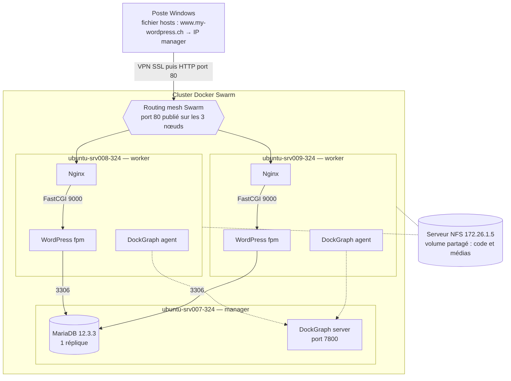
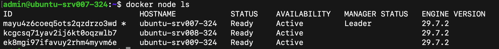

# 347-docker-swarm-wordpress
 
## 1. Informations du projet
 
**Titre** — Docker Swarm Wordpress, projet P_DevOps 347 (CdC v4 du 07.09.2026), 1er trimestre, ~24 périodes.
 
**Élève** — Latif Krasniqi, classe CID3A, ETML. **Client** — Mathieu Meylan.
 
**Objectif** — Déployer WordPress en haute disponibilité avec Docker Swarm : orchestration, équilibrage de charge, mise à l'échelle et tolérance aux pannes. Architecture multi-conteneurs : un proxy inverse Nginx, un service WordPress répliqué en `fpm`, une base MariaDB.
 
**Périmètre et contraintes**
 
- 3 VM Linux : 1 manager + 2 workers.
- Mise en place **uniquement en CLI**, aucune interface graphique.
- Images imposées : MariaDB 12.3.3, WordPress fpm-alpine 7.1.0, Nginx 1.30.4 (alpine 3.24).
- Mots de passe en secrets Docker, jamais dans le dépôt.
- Deux réseaux overlay : `frontend` et `backend`.
- Code WordPress en volume partagé, pour la persistance des médias.
- DockGraph installé pour visualiser la stack.
- Accès par `http://www.my-wordpress.ch`.

---
 
## 2. Analyse et choix techniques
 
| Composant | Image | Rôle | Exposition |
| --- | --- | --- | --- |
| Nginx | `nginx:1.30.4-alpine3.24` | Proxy inverse, sert les ressources statiques | Port 80 publié |
| WordPress | `wordpress:7.1.0-php8.3-fpm-alpine` | PHP-FPM, génère les pages | Port 9000, `backend` seul |
| MariaDB | `mariadb:12.3.3` | Base de données | Aucun port publié |
| DockGraph | `registry.matinfo.ch/dockgraph:0.10-swarm` | Visualisation du cluster | Port 7800 |
 
### Risques et limites
 
**Persistance** — Deux volumes : code et médias WordPress sur NFS (visible des 3 nœuds), données MariaDB en `local` (liée à un nœud).
 
**Panne d'un nœud** — Nginx et WordPress sont répliqués une fois par worker : la perte d'un worker laisse le site accessible. MariaDB, en une réplique sur le manager, reste un point de défaillance unique.
 
**Réplique en `Pending`** — Avec `max_replicas_per_node: 1`, la perte d'un worker laisse une réplique `Running` et une `Pending` : la contrainte interdit d'en mettre deux sur le worker restant. C'est le comportement attendu. La réplique repart au retour du nœud.
 
**Pas de rééquilibrage** — Swarm ne redistribue pas les tâches quand un nœud revient. Pour forcer : `docker service update --force wp_wordpress`.
 
**Stockage** — Le serveur NFS est externe au cluster : s'il tombe, Nginx et WordPress ne démarrent sur aucun nœud.
 
**Base de données** — `replicas: 1` volontaire : deux instances sur le même volume corrompraient les fichiers.
 
**Sessions** — WordPress n'utilise pas les sessions PHP pour la connexion, mais un cookie signé. Les clés de signature sont dans `wp-config.php`, sur le volume NFS partagé, et les jetons de session sont en base : les deux répliques peuvent donc vérifier n'importe quel cookie, et l'utilisateur reste connecté quelle que soit la réplique qui répond. Un plugin utilisant `$_SESSION` casserait cette propriété, ces sessions étant stockées dans chaque conteneur.
 
**Socket Docker** — DockGraph a accès au socket Docker de chaque nœud, c'est-à-dire à la commande de Docker sur la machine. Quelqu'un qui en prendrait le contrôle pourrait tout faire sur la VM. Deux protections : un mot de passe sur l'interface, et le port 7801 des agents qui n'est jamais publié.
 
---
 
## 3. Architecture
 

 
### Flux
 
1. La machine résout `www.my-wordpress.ch` par son fichier `hosts` vers l'IP du manager.
2. Swarm route la requête vers une réplique Nginx, y compris depuis un nœud qui n'en héberge aucune.
3. Nginx sert les ressources statiques ; pour le reste, `try_files` renvoie vers `index.php` et le bloc FastCGI transmet à `wordpress:9000`.
4. WordPress exécute le script et interroge `db:3306` sur `backend`.
5. La réponse remonte à Nginx, qui la renvoie au client.

### Nœuds
 
| Nom | Rôle | IP | Responsabilité |
| --- | --- | --- | --- |
| ubuntu-srv007-324 | manager | `172.26.1.16` | Gestion du cluster, MariaDB, serveur DockGraph |
| ubuntu-srv008-324 | worker | `172.26.1.17` | 1 Nginx, 1 WordPress, agent DockGraph |
| ubuntu-srv009-324 | worker | `172.26.1.18` | 1 Nginx, 1 WordPress, agent DockGraph |
 
Utilisateur SSH : `admin`.
 
### Réseaux
 
| Réseau | Driver | Services | Rôle |
| --- | --- | --- | --- |
| `wp_frontend` | overlay | nginx | Réception des requêtes extérieures |
| `wp_backend` | overlay | nginx, wordpress, db | Nginx ↔ PHP-FPM et WordPress ↔ MariaDB |
| `dockgraph_internal` | overlay | server, agent | Serveur ↔ agents DockGraph |
 
Nginx est le seul service sur les deux réseaux. WordPress et MariaDB n'ont aucune route vers l'extérieur.
 
### Volumes
 
| Nom | Type | Contenu | Partage |
| --- | --- | --- | --- |
| `wp_wp_volume` | NFS `172.26.1.5:/var/nfs_share/nfs02` | Code, thèmes, plugins, médias | wordpress en lecture/écriture, nginx en lecture seule, même chemin `/var/www/html` |
| `wp_db_volume` | `local` | Base MariaDB | Non partagé — d'où `node.role == manager` sur `db` |
 
Le même chemin des deux côtés est impératif : Nginx transmet à PHP-FPM un chemin absolu que celui-ci résout chez lui.
 
---
 
## 4. Prérequis
 
**Matériel** — Un PC ETML sous Windows, 3 VM Ubuntu Server, un serveur NFS (172.26.1.5).
 
**Logiciels** — Docker Engine et `nfs-common` sur les trois VM, un client SSH sur le poste Windows, droits administrateur sur son fichier `hosts`, accès HTTPS des nœuds vers `registry.matinfo.ch`, identifiants du registre (`matregistry`) fournis par l'enseignant.
 
**Accès réseau** — Les VM sont sur l'infrastructure Protocol, joignable par VPN. Le client FortiClient VPN est préinstallé sur les postes ETML ; sur une machine personnelle, il se télécharge sur <https://www.fortinet.com/support/product-downloads> (`FortiClientVPNInstaller.exe`).
 
Paramètres de la connexion :
 
| Champ | Valeur |
| --- | --- |
| Type | VPN SSL |
| Nom | Protocole |
| Passerelle distante | `vpn-labetml.protocloud.ch` |
| Port personnalisé | 443 |
| Nom d'utilisateur | `etml-student` |
| Mot de passe | fourni par l'enseignant (`README-VPN-INSTALL.md`), non versionné |
 
Coller le mot de passe via un éditeur de texte, pour éviter les caractères invisibles. Le VPN doit être actif avant toute connexion SSH ou tout accès à `http://www.my-wordpress.ch`.
 
---
 
## 5. Accès SSH
 
| VM | Nom DNS | IP | Utilisateur |
| --- | --- | --- | --- |
| Manager | ubuntu-srv007-324 | `172.26.1.16` | admin |
| Worker 1 | ubuntu-srv008-324 | `172.26.1.17` | admin |
| Worker 2 | ubuntu-srv009-324 | `172.26.1.18` | admin |
 
```bash
ssh admin@<ip-de-la-vm>
```
 
**Préconditions** — Droits `sudo` sur les trois VM. Ports ouverts entre les nœuds : `2377/tcp`, `7946/tcp+udp`, `4789/udp`, `22/tcp`, `80/tcp`, `7800/tcp`, `2049/tcp` vers le NFS, `443/tcp` vers le registre. Le port `7801/tcp` des agents DockGraph ne doit **pas** être ouvert.
 
**Authentification** — par clé SSH. Aucune clé n'est versionnée dans le dépôt.

**Secrets** — Aucun mot de passe ni clé privée n'est versionné. Les valeurs sont créées sur le manager par `docker secret create` (§7.4 et §7.6) et transmises à l'enseignant lors de la démonstration.
 
---
 
## 6. Structure du dépôt
 
```
347-docker-swarm-wordpress/
├── docker-compose.yml        # stack WordPress
├── dockgraph.yml             # stack DockGraph (serveur + agents)
├── nginx/conf.d/default.conf # config Nginx : proxy inverse + FastCGI
├── architecture.png          # diagramme d'architecture
├── preuvetest/               # captures des tests (§11)
└── README.md
```
 
Chaque directive des deux fichiers Compose est commentée.
 
---
 
## 7. Déploiement pas à pas
 
### 7.1 Préparation des VM
 
Sur **chacune des trois** :
 
```bash
docker --version
sudo apt install -y nfs-common
showmount -e 172.26.1.5
sudo mkdir -p /mnt/test && sudo mount -t nfs 172.26.1.5:/var/nfs_share/nfs02 /mnt/test && sudo umount /mnt/test
```
 
*Attendu* : Docker répond, `/var/nfs_share/nfs02` figure dans les exports, le montage manuel réussit.
 
### 7.2 Initialisation du Swarm
 
Sur le manager :
 
```bash
docker swarm init --advertise-addr <ip-manager>
```
 
`--advertise-addr` indique aux workers par quelle adresse joindre le manager ; il est obligatoire dès que la VM a plusieurs interfaces.
 
*Attendu* : `Swarm initialized`, suivi de la commande de jointure à conserver.
 
### 7.3 Jointure des workers
 
Sur **chaque worker** :
 
```bash
docker swarm join --token <TOKEN> <ip-manager>:2377
```
 
Pour réafficher le jeton : `docker swarm join-token worker` sur le manager. Contrôle :
 
```bash
docker node ls
```
 
*Attendu* : 3 nœuds `Ready`/`Active`, un `Leader`. La commande échoue sur un worker — c'est le moyen le plus simple de savoir où l'on est.
 
### 7.4 Création des secrets
 
Réseaux, volumes et config sont créés par le déploiement. Les secrets, déclarés `external`, doivent exister avant. Sur le manager :
 
```bash
printf '%s' '<mdp-root>' | docker secret create db_root_password -
printf '%s' '<mdp-wordpress>' | docker secret create db_password -
docker secret ls
```
 
`printf` et non `echo` : ce dernier ajoute un retour à la ligne qui ferait partie du mot de passe.
 
*Attendu* : les deux secrets listés. `docker secret inspect` ne montre jamais la valeur.
 
### 7.5 Déploiement de la stack WordPress
 
```bash
docker stack deploy -c docker-compose.yml wp
docker stack services wp
docker stack ps wp
```
 
*Attendu*, après une à deux minutes : `nginx` et `wordpress` à `2/2`, `db` à `1/1`. La colonne `NODE` doit montrer une réplique Nginx et une WordPress par worker, MariaDB sur le manager.
 
### 7.6 Installation de DockGraph
 
L'image est sur le registre privé de l'école.
 
```bash
docker login -u matregistry https://registry.matinfo.ch
docker pull registry.matinfo.ch/dockgraph:0.10-swarm
 
openssl rand -hex 32 | docker secret create dg_agent_token -
printf '%s' '<mdp-dockgraph>' | docker secret create dg_password -
 
docker stack deploy --with-registry-auth -c dockgraph.yml dockgraph
docker stack services dockgraph
```
 
`--with-registry-auth` transmet les identifiants aux workers ; sans lui, ils ne peuvent pas télécharger l'image de leur agent.
 
*Attendu* : `server` à `1/1` sur le manager, `agent` à `3/3`.
 
Accès : `http://<ip-d-un-noeud>:7800`. L'authentification se fait **par mot de passe seul**, il n'y a pas de nom d'utilisateur.
 
| Problème | Cause |
| --- | --- |
| `pull access denied` sur les workers | `--with-registry-auth` oublié |
| `agent` à `2/3` | Erreur de téléchargement sur un nœud : `docker service ps dockgraph_agent --no-trunc` |
| Port 7800 injoignable | Pare-feu, ou `docker service logs dockgraph_server` |
| Pas de stats pour un nœud | Agent arrêté, ou ports 7946/4789 bloqués |
| `secret not found` | Secrets non créés avant le déploiement |
| Mot de passe oublié | `docker stack rm dockgraph`, `docker secret rm dg_password`, recréer, redéployer |
 
### 7.7 Nom de domaine sur le poste Windows
 
Dans `C:\Windows\System32\drivers\etc\hosts`, avec un éditeur lancé en administrateur :
 
```
172.26.1.16    www.my-wordpress.ch
```
 
Le fichier `hosts` est consulté avant tout DNS. L'IP du manager est préférable : Swarm relaie vers les répliques même s'il n'en héberge aucune, et il reste joignable pendant le test de panne d'un worker.
 
*Attendu* : `ping www.my-wordpress.ch` répond avec cette IP.
 
### 7.8 Installation de WordPress
 
Ouvrir `http://www.my-wordpress.ch` : l'assistant demande la langue, le titre du site et le compte administrateur.
 
---
 
## 8. Configuration des services
 
**MariaDB** — Base et utilisateur applicatif créés au premier démarrage. L'utilisateur `user` n'a de droits que sur `appdb`. Mots de passe lus dans `/run/secrets/`. Données sur `/var/lib/mysql`, chemin imposé par l'image. Healthcheck : `healthcheck.sh --connect --innodb_initialized`.
 
**WordPress** — Image `fpm` : elle ne contient que PHP-FPM, qui parle FastCGI sur le port 9000 et **pas HTTP**. Elle ne peut donc pas être exposée seule. `WORDPRESS_DB_HOST: db:3306` désigne le service par son nom, résolu par le DNS interne de Swarm. Healthcheck : présence du processus `php-fpm`, faute de port HTTP.
 
**Nginx** — Véritable serveur web : il sert les ressources statiques et ne délègue que les `.php`. Points clés de `default.conf` :
 
- `server_name www.my-wordpress.ch` — comparé à l'adresse tapée par le visiteur.
- `root /var/www/html` — doit correspondre au chemin du volume dans les deux conteneurs.
- `try_files $uri $uri/ /index.php?$args` — fait marcher les permaliens, dont les URL ne correspondent à aucun fichier.
- `fastcgi_param SCRIPT_FILENAME …` — chemin du fichier à exécuter ; déclaré après `include fastcgi_params`, la dernière définition l'emportant.
- `client_max_body_size 64M` — la limite par défaut de 1 Mo bloquerait l'envoi de médias.

La config est distribuée par un objet `config` du cluster. Ces objets sont **immuables** : modifier le fichier et redéployer ne change rien, il faut recréer la config sous un autre nom ou utiliser `docker service update --config-rm/--config-add`.
 
**DockGraph** — Graphe temps réel du cluster, bascule Network/Node, vue tableau, logs consolidés. Deux services : `server` sur le manager (seul un manager interroge l'API Swarm) et `agent` en mode global, qui remonte les données de son nœud. Socket Docker en lecture seule : outil de consultation uniquement, la mise en place restant en CLI.
 
### Secrets
 
Swarm monte chaque secret en mémoire dans `/run/secrets/<nom>` ; la valeur ne touche jamais le disque. Les images officielles acceptent une variante `_FILE` des variables de mot de passe : elles reçoivent le chemin du fichier au lieu de la valeur.
 
**Le suffixe `_FILE` est indispensable.** Sans lui, `MARIADB_ROOT_PASSWORD=/run/secrets/db_root_password` donne un mot de passe qui vaut littéralement ce chemin : le secret est monté mais jamais lu.
 
`db_password` est référencé par `db` (qui crée l'utilisateur) et par `wordpress` (qui s'y connecte) : un secret unique garantit que les deux ne divergent pas. Le mot de passe admin WordPress, lui, est stocké haché en base.
 
### Répliques et placement
 
| Service | Répliques | Placement | Ports |
| --- | --- | --- | --- |
| nginx | 2 | `node.role == worker`, `max_replicas_per_node: 1` | `80:80` |
| wordpress | 2 | `node.role == worker`, `max_replicas_per_node: 1` | aucun |
| db | 1 | `node.role == manager` | aucun |
| dockgraph server | 1 | `node.role == manager` | `7800:7800` |
| dockgraph agent | global | une par nœud | aucun |
 
La contrainte sur `db` vient de son volume `local` : ailleurs, le service repartirait d'un répertoire vide.
 
`max_replicas_per_node: 1` corrige un comportement du scheduler : Swarm répartit selon la charge mais ne garantit pas une réplique par nœud. Après un redémarrage ou une panne, les deux pourraient se retrouver sur le même worker — et la panne de ce worker couperait le site malgré le `2/2` affiché.
 
Les `limits` plafonnent CPU et mémoire pour qu'un service emballé ne prive pas les autres. Les `reservations` restent basses : une réservation supérieure aux ressources libres d'un nœud rendrait le placement impossible.
 
### Équilibrage de charge
 
Deux niveaux. Swarm intercepte le port 80 sur les trois nœuds et distribue vers une réplique Nginx disponible, même sur une autre machine — c'est ce qui permet de pointer le fichier `hosts` vers le manager. Puis le DNS interne répartit les appels `fastcgi_pass wordpress:9000` entre les répliques WordPress, via une IP virtuelle. Nginx n'a aucune configuration d'équilibrage : c'est aussi pourquoi `docker service scale` prend effet sans le redéployer.
 
---
 
## 9. Exploitation
 
### Lister et inspecter
 
```bash
docker node ls
docker stack services wp                   # état des répliques
docker service ps wp_wordpress             # répartition sur les nœuds
docker service inspect wp_nginx
docker network inspect wp_backend
docker volume ls                           # volumes, locaux à chaque nœud
docker secret ls && docker config ls
```
 
### Mettre à jour et mettre à l'échelle
 
```bash
docker service scale wp_wordpress=4
docker stack deploy -c docker-compose.yml wp
docker service update --force wp_wordpress   # force la redistribution
```
 
Avec deux workers et `max_replicas_per_node: 1`, demander plus de deux répliques laisse les excédentaires en `Pending`.
 
### Logs et santé
 
```bash
docker service logs -f wp_db
docker ps --format "table {{.Names}}\t{{.Status}}"          # sur un nœud : (healthy)
docker inspect --format '{{json .State.Health}}' <id>        # détail des derniers tests
```
 
### Diagnostic
 
```bash
docker stack ps wp --no-trunc
```
 
La colonne `ERROR` donne la cause exacte ; `--no-trunc` évite qu'elle soit coupée. Un service qui semble « se déplacer » est un service qui échoue et que Swarm relance ailleurs en boucle.
 
| Message | Cause |
| --- | --- |
| `failed to mount local volume: permission denied` | Chemin NFS absent des exports. Vérifier avec `showmount -e` et monter à la main. |
| Page « Welcome to nginx » | Bloc `configs:` absent du service : la config n'était pas montée. |
| `network ... not found` | Déclaration de réseau mal indentée. |
| `refers to undefined volume` | Volume utilisé mais absent de la section `volumes:`. |
| Connexion acceptée avec un mauvais mot de passe | Variables écrites sans `_FILE` : la base avait été initialisée avec le chemin comme mot de passe. |
 
Vérifier qu'une config ou un secret est bien arrivé :
 
```bash
docker exec <id> cat /etc/nginx/conf.d/default.conf
docker exec <id> ls -la /run/secrets/
```
 
Après modification des `driver_opts` d'un volume, le supprimer **sur chaque nœud** avant de redéployer : Docker garde l'ancienne définition en cache.
 
### Test de tolérance aux pannes
 
```bash
docker stack ps wp                                          # référence : 1 réplique par worker
docker node update --availability drain ubuntu-srv008-324
docker service ps wp_wordpress                              # 1 Running, 1 Pending
curl -I -H "Host: www.my-wordpress.ch" http://127.0.0.1/    # le site répond
docker node update --availability active ubuntu-srv008-324
```
 
Résultat : voir test 9 du §11.
 
---
 
## 10. Accès aux interfaces
 
| Interface | URL | Utilisateur | Mot de passe |
| --- | --- | --- | --- |
| Site | `http://www.my-wordpress.ch` | — | — |
| Admin WordPress | `http://www.my-wordpress.ch/wp-admin` | latif | 123test123 |
| DockGraph | `http://172.26.1.16:7800` | *aucun* | LKK200900 |
 
---
 
## 11. Validation
 
| # | Critère | Commande / action | Attendu | Observé | Preuve |
| --- | --- | --- | --- | --- | --- |
| 1 | Cluster à trois nœuds | `docker node ls` | 3 nœuds `Ready`/`Active`, 1 `Leader` | 3 nœuds `Ready`/`Active`, srv007 `Leader` |  |
| 2 | Site accessible | `ping www.my-wordpress.ch` | L'url reçoit les paquets | `www.my-wordpress.ch` résolu vers 172.26.1.16, paquets reçus |  |
| 3 | Réplication WordPress | `docker service ps wp_wordpress` | 2 tâches `Running`, une par worker | 2 tâches `Running`, une sur srv008, une sur srv009 |  |
| 4 | Persistance MariaDB et médias | Image téléversée dans la médiathèque | Image présente, stockée sur le volume NFS | Image présente dans la médiathèque |  |
| 5 | Secrets | `ls /run/secrets/`, puis mauvais et bon mot de passe | Fichiers montés ; mauvais mot de passe refusé | 2 secrets montés ; `Access denied` avec le mauvais, connexion acceptée avec le bon |  |
| 6 | Réseaux séparés | `docker network inspect` des deux réseaux | MariaDB absente de `frontend` | MariaDB présente sur `backend`, absente de `frontend` |  |
| 7 | Nginx en proxy inverse | `curl -I -H "Host: www.my-wordpress.ch" http://127.0.0.1/` | `Server: nginx` et `X-Powered-By: PHP` | `200 OK`, `Server: nginx/1.30.4`, `X-Powered-By: PHP/8.3.33` |  |
| 8 | DockGraph | `docker stack services dockgraph` | `server` 1/1, `agent` 3/3 | `server` 1/1, `agent` 3/3 (global) |  |
| 9 | Bascule après panne | `drain` d'un worker | Site maintenu, 1 `Running` + 1 `Pending` | srv008 en `DRAIN`, Nginx et WordPress sur srv009, 2 tâches en attente, site en `200 OK` |  |
 
### Écarts avec le cahier des charges
 
**MariaDB sur le manager** — Volume `local`, donc lié à un nœud. La contrainte garantit la persistance mais fait du manager un point de défaillance unique pour la base. Solution complète : volume sur NFS, ou réplication MariaDB — hors périmètre.
 
**Réplique en `Pending` pendant une panne** — Conséquence assumée de `max_replicas_per_node: 1` : capacité réduite plutôt que deux répliques sur un même nœud.
 
**Nginx en deux répliques** — Non chiffré par le CdC, qui ne parle de répliques que pour WordPress. Évite que le point d'entrée soit unique.
 
---
 
## 12. Suppression complète
 
> ⚠️ La suppression des volumes efface définitivement le site, les médias et la base. Aucune récupération possible.
 
```bash
# 1. Les deux stacks
docker stack rm wp
docker stack rm dockgraph
sleep 15                      # laisser les tâches se terminer
 
# 2. Les secrets (impossible tant qu'un service les utilise)
docker secret rm db_root_password db_password dg_password dg_agent_token
 
# 3. Les réseaux, si des résidus subsistent
docker network ls | grep -E 'wp_|dockgraph'
docker network rm wp_frontend wp_backend dockgraph_internal
 
# 4. Les volumes — SUR CHACUN DES TROIS NŒUDS
docker volume rm wp_wp_volume wp_db_volume
```
 
Supprimer `wp_wp_volume` retire le montage NFS mais **ne vide pas le partage** : pour effacer réellement les fichiers, vider `/var/nfs_share/nfs02` sur le serveur 172.26.1.5. DockGraph n'utilise aucun volume.
 
Nettoyage facultatif des images, sur chaque nœud : `docker image prune -a`.
 
**Quitter le Swarm (facultatif)**
 
```bash
# sur chaque worker
docker swarm leave
# sur le manager
docker node rm ubuntu-srv008-324 ubuntu-srv009-324
docker swarm leave --force
```
 
`--force` est nécessaire sur le dernier manager, Docker refusant de démanteler un cluster depuis son nœud de gestion.
 
---
 
## 13. Traçabilité et sources
 
**Kanban GitHub Projects** — <https://github.com/users/latifcodess/projects/1>.
 
**Journal de travail** — `Journal-de-Travail_KrasniqiLatif.xls`, accessible à l'enseignant sur Teams.
 
**Sources**
 
- Docker Swarm — <https://docs.docker.com/engine/swarm/>
- Secrets et configs — <https://docs.docker.com/engine/swarm/secrets/>, <https://docs.docker.com/engine/swarm/configs/>
- Placement et `max_replicas_per_node` — <https://docs.docker.com/reference/compose-file/deploy/>
- Images officielles — <https://hub.docker.com/_/wordpress>, <https://hub.docker.com/_/mariadb>, <https://hub.docker.com/_/nginx>
- Module FastCGI de Nginx — <https://nginx.org/en/docs/http/ngx_http_fastcgi_module.html>
- DockGraph — guide fourni par l'enseignant (01.10.2026)

**Outils d'intelligence artificielle** — J'ai utilisé Claude (Anthropic) comme aide à la compréhension tout au long du projet : concepts de Docker Swarm (nœuds, services, répliques, réseaux overlay, secrets, volumes), configuration Nginx et communication avec PHP-FPM, et rôle de chaque directive de mon docker-compose afin de pouvoir le commenter. L'IA m'a aussi aidé à diagnostiquer les erreurs de déploiement et a produit une première version de ce README. Je l'ai ensuite relue et humanisée : reformulée avec mes mots, raccourcie, corrigée et complétée pour qu'elle corresponde à l'infrastructure que j'ai moi-même déployée et testée. Le déploiement, les tests, les captures et les commits ont été réalisés par moi, et je suis en mesure d'expliquer l'ensemble des fichiers livrés.